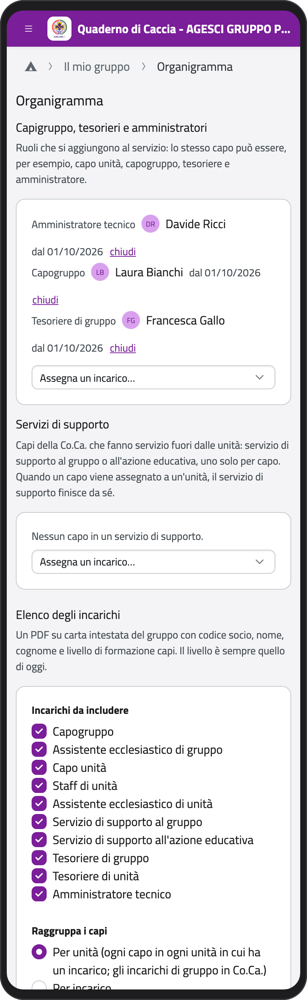
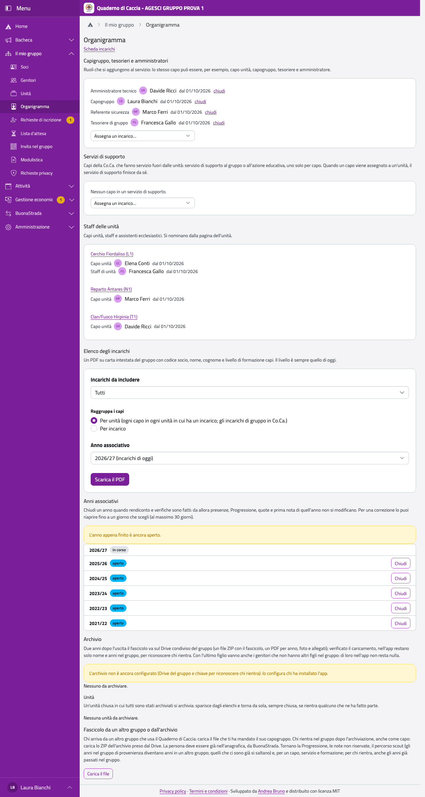
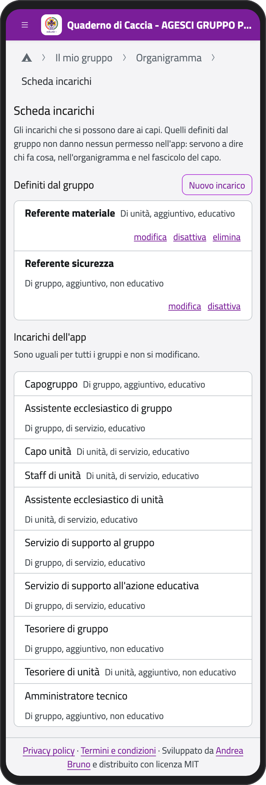
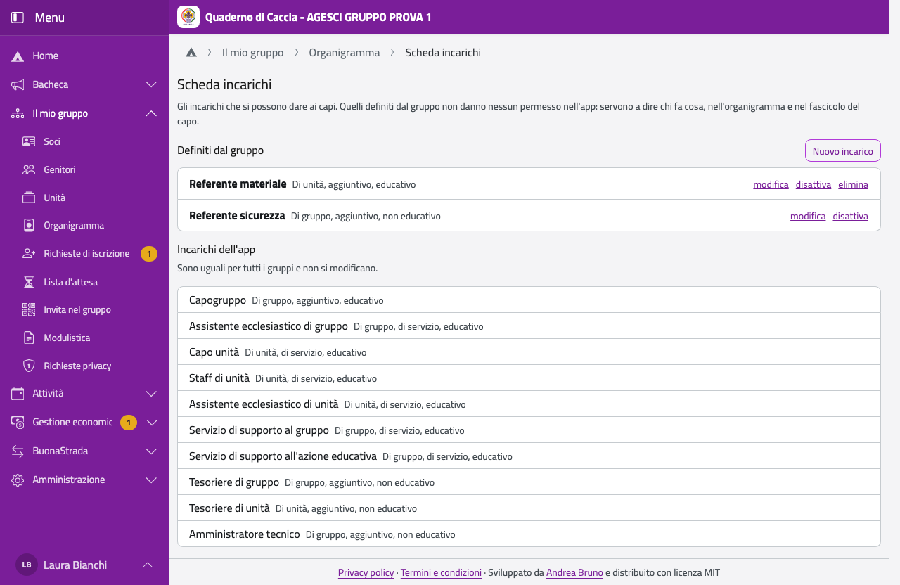
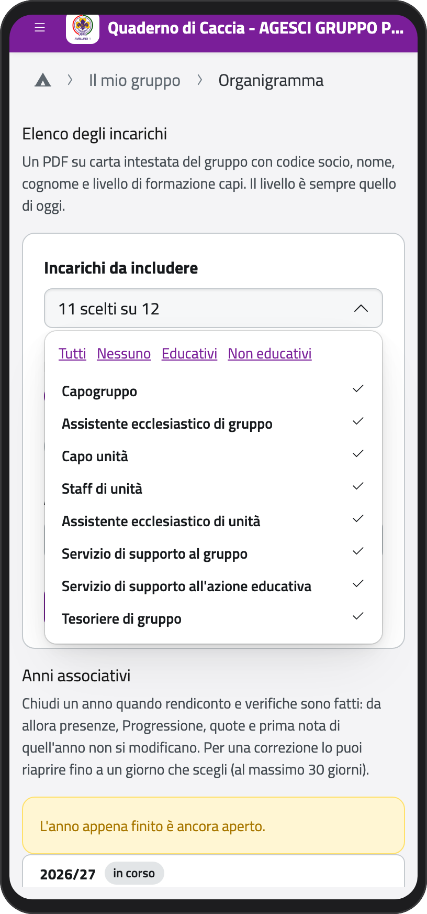
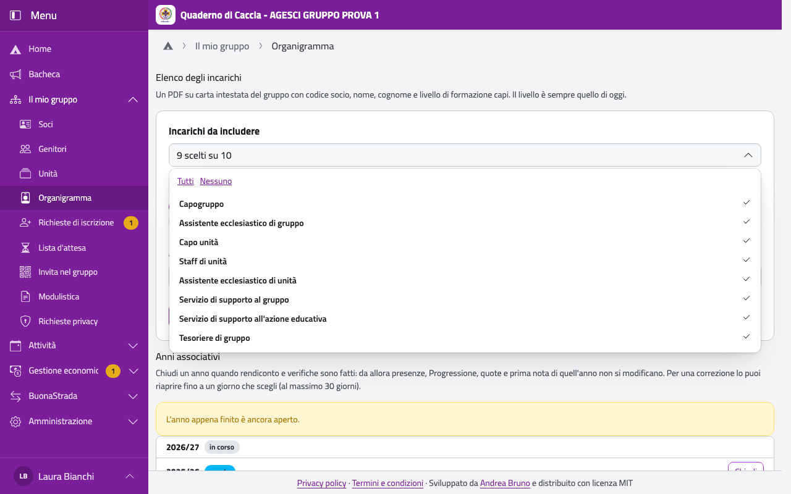

# Unità e incarichi

## Le unità

In **Il mio gruppo**, tocca **Unità**. Solo i capigruppo creano, rinominano e chiudono le
unità.

- **Nuova unità**: nome, tipo, composizione (maschile, femminile, mista) e, per un
  Branco/Cerchio, l'ambientazione (giungla o bosco). La Comunità capi può non avere nome.
- Nella pagina di un'unità, **Modifica** per cambiare nome o ambientazione, collegarla a
  un'altra unità o chiuderla (togli la spunta da **Unità attiva**).

**Unità collegate.** Due unità che lavorano insieme, per esempio un reparto maschile e uno
femminile paralleli, si collegano con **Collegata a**: il collegamento vale per tutte e due,
e lo staff delle due unità conta come uno solo: chi è nello staff di una può fare nell'altra
tutto quello che fa nella sua (progressione, dati sanitari, squadriglie, eventi e presenze),
tranne la cassa, che resta di ogni unità finché non unite le casse (vedi sotto).
Un'unità si collega a una sola altra unità, attiva e non ancora collegata. Per cambiare
collegamento, prima scegli **Nessuna** e salva, poi collega la nuova unità.

**Cassa comune.** Due unità collegate possono avere una sola cassa contanti. Nella pagina di
una delle due, un capo unità o un capogruppo tocca **Unisci le casse** e conferma: da
quel giorno i saldi delle due casse si sommano in una sola (l'app registra il giroconto),
i tesorieri di ciascuna unità valgono per tutte e due e la prima nota di una mostra i
movimenti di entrambe. Si dividono di nuovo, con **Dividi le casse**, solo all'inizio di un
anno scout, prima di ogni movimento dell'anno. Finché le casse sono unite, il
collegamento tra le due unità non si toglie.

Le unità arrivano di solito dall'importazione da BuonaStrada, senza nome: il riquadro **Da
controllare** dell'unità te lo ricorda.

Un'unità chiusa in cui non c'è mai stato nessuno, per esempio creata per errore, si elimina
dalla sua pagina: **Elimina…** e **Confermo**. Se ci è stato qualcuno resta, chiusa, per lo
storico; quando tutte le persone del suo storico sono archiviate, la archivi da [Fine anno e
archivio](fine-anno).

## Lo staff delle unità

Nella pagina dell'unità, in **Staff e incarichi**, scegli **Capo unità** o **Staff** in
**Assegna un incarico…**, la persona in **Chi**, e tocca **Assegna**. I capi unità sono al
massimo due nelle unità miste e in Comunità capi, uno nelle altre. Per chiudere un incarico,
**chiudi**.

L'**Assistente ecclesiastico di unità** si assegna allo stesso modo, dai capigruppo o dal
capo unità: nell'app conta come lo staff dell'unità.

Assistente ecclesiastico, di unità o di gruppo, può essere solo un presbitero: nell'elenco
compaiono solo i capi che in BuonaStrada hanno la professione «Presbitero». Se manca qualcuno,
correggi prima la professione nella sua scheda.

## L'organigramma

In **Il mio gruppo**, tocca **Organigramma**.

:::{container} schermate
{.telefono width="30%"}
{.computer width="65%"}
:::

- **Capigruppo, tesorieri e amministratori**: capogruppo e tesoriere di gruppo (al massimo
  due ciascuno), amministratore tecnico. Si aggiungono al servizio: lo stesso capo può
  essere capo unità e tesoriere. Qui si nomina anche l'**Assistente ecclesiastico di
  gruppo**, che nell'app ha gli stessi poteri di un capogruppo.
- **Servizi di supporto**: i capi della Comunità capi che fanno servizio fuori dalle unità,
  nel **servizio di supporto al gruppo** o nel **servizio di supporto all'azione
  educativa**; uno solo per capo. Quando un capo viene assegnato a un'unità, il servizio
  di supporto finisce da solo. Prima c'era «a disposizione»: chi lo ha ancora compare in
  un avviso; scegli uno dei due servizi e «a disposizione» si chiude da solo.
- **Staff delle unità**: per ogni unità, nell'ordine Lupetti e Coccinelle, Esploratori e
  Guide, Rover e Scolte, il capo unità, lo staff e l'assistente ecclesiastico. I capigruppo
  li assegnano e li chiudono anche da qui, come nella pagina dell'unità, che si apre toccando
  il suo nome. Gli altri capi qui guardano soltanto.

In alto un avviso elenca i **capi senza servizio**: assegnali a un'unità o a un servizio di
supporto. Un capogruppo senza un'unità non è nell'elenco: il suo servizio è il gruppo.

Un altro avviso, solo per i capigruppo, elenca i **capi inseriti in più unità**, come capo
unità o staff. Non è un errore, un capo può servire più unità: è un promemoria per controllare
che sia voluto. Due unità collegate contano come una e l'assistente ecclesiastico non conta.

### La scheda degli incarichi

Oltre agli incarichi dell'app, il gruppo può definirne di suoi, per esempio un referente per la
sicurezza. In alto nell'organigramma tocca **Scheda incarichi**: tutti i capi la leggono, solo i
capigruppo definiscono e assegnano gli incarichi nuovi, e solo a dei capi.

:::{container} schermate
{.telefono width="30%"}
{.computer width="65%"}
:::

1. Tocca **Nuovo incarico** e scrivi il **Nome**.
2. Scegli **Dove vale**: un incarico **di gruppo** si assegna nell'organigramma, uno **di
   unità** dalla pagina dell'unità.
3. Scegli il rapporto col servizio del capo. **Aggiuntivo** si somma a quello che il capo già
   fa. **Di servizio** è il servizio del capo, che così non è più tra i capi senza servizio:
   - di gruppo, funziona come un servizio di supporto: esclude il servizio in un'unità e gli
     altri supporti e finisce da solo quando il capo viene assegnato a un'unità;
   - di unità, esclude i servizi di supporto e li chiude quando viene assegnato.
4. Spunta **Educativo** se lo è. Conta solo per la scelta rapida nel PDF dell'elenco.
5. Tocca **Salva**.

:::{warning}
Un incarico definito dal gruppo non dà **nessun permesso** nell'app. Anche un servizio di unità
non fa entrare il capo nello staff: non vede i dati dell'unità. Se deve vederli, nominalo nello
staff.
:::

Un incarico già assegnato non cambia più tra gruppo e unità né tra aggiuntivo e di servizio, e
non si elimina: tocca **disattiva**. Non viene più proposto, e chi lo ha lo tiene finché non
tocchi **chiudi** accanto al suo nome. Gli incarichi dell'app sono in fondo alla pagina, in sola
lettura.

### L'elenco degli incarichi

In fondo alla pagina, in **Elenco degli incarichi**, un capogruppo stampa un PDF su carta
intestata del gruppo con codice socio, cognome, nome e livello di formazione capi di ogni
capo. Cognome e nome sono in maiuscolo, come negli elenchi di BuonaStrada. In ogni unità
vengono prima i capi unità e in Comunità capi i capigruppo, la capo prima del capo; poi gli
altri in ordine di cognome.

1. Apri il menu **Incarichi da includere** e tocca gli incarichi da togliere o da
   rimettere (di base ci sono tutti). In cima, in un colpo: **Tutti**, **Nessuno**, **Educativi**
   (tutti tranne tesorieri e amministratore tecnico) e **Non educativi** (tesoriere di gruppo,
   tesoriere di unità, amministratore tecnico).
   Tocca fuori dal menu per chiuderlo.
2. Scegli come raggruppare i capi: **Per unità** o **Per incarico**. Per unità, ogni
   incarico sta nella sua sezione: quelli di un'unità nell'unità, quelli di gruppo
   (capogruppo, assistente ecclesiastico di gruppo, tesoriere di gruppo, amministratore,
   servizi di supporto) in Comunità capi. Un capo compare in ogni sezione in cui ha un
   incarico spuntato, anche più volte, e accanto al nome ha gli incarichi di quella sezione.
   Un capo senza servizio, per esempio un tesoriere, compare anche in Comunità capi con
   «Servizio di supporto al gruppo».
3. Scegli l'**Anno associativo**: quello in corso dà gli incarichi di oggi; un anno passato
   quelli che erano in corso alla sua fine, il 30 settembre.
4. Tocca **Scarica il PDF**.

:::{container} schermate
{.telefono width="30%"}
{.computer width="65%"}
:::

Il livello di formazione è sempre quello di oggi, anche per un anno passato. Un capo appena
entrato dall'app, che ha ancora il codice socio provvisorio, compare con «NUOVO CENSITO» al
posto del codice e con il livello 1: è un tirocinante finché BuonaStrada non dice altro.

## Le eccezioni sulle squadriglie

Le squadriglie sono maschili o femminili. Quando la Comunità capi decide un'eccezione, un
capogruppo la registra nella scheda del ragazzo/a, in **Eccezioni sulla squadriglia**:

1. Tocca **Registra**.
2. Scegli il reparto, se può entrare nelle squadriglie **femminili** o **maschili**, il giorno
   della decisione in Co.Ca. e una **Motivazione** breve (è un dato delicato: la leggono tutti
   i capi).
3. Tocca **Registra**.

Con **revoca** la togli da oggi. L'eccezione finisce da sola quando il ragazzo/a lascia il
reparto. Ogni lettura resta nel registro degli accessi.
