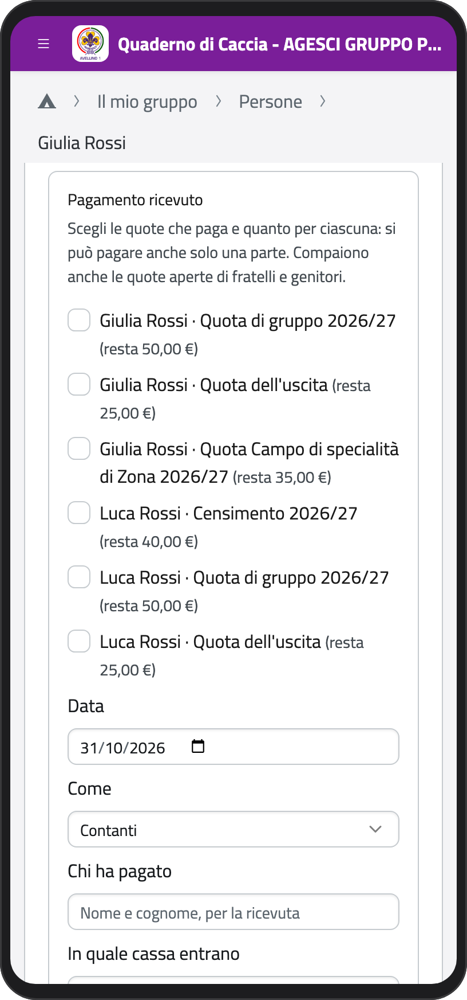
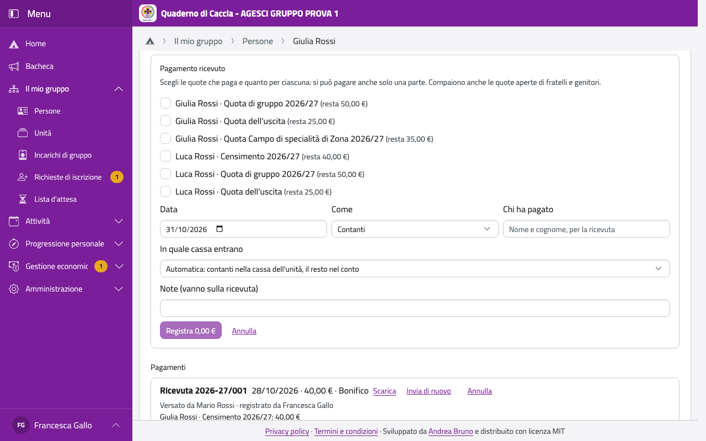
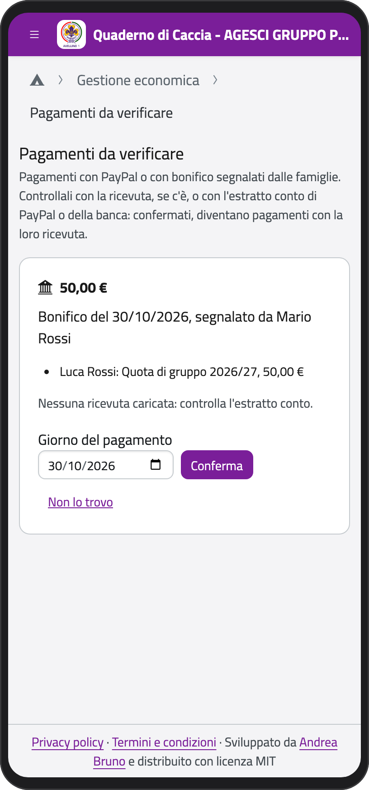
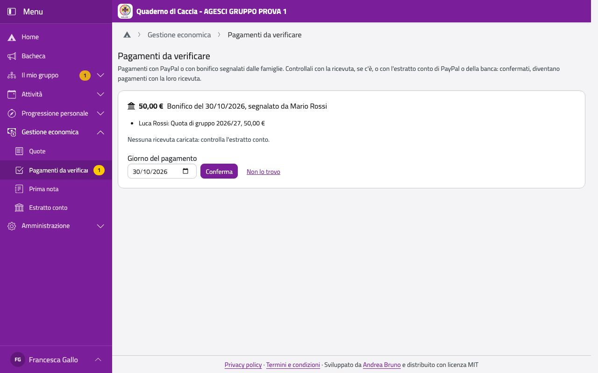

# Pagamenti e ricevute

## Registrare un pagamento

Quando una famiglia ti dà i soldi (o vedi un bonifico):

1. Apri la scheda del ragazzo e, nel riquadro **Quote**, tocca **Registra un pagamento**.
2. Spunta le quote che paga e quanto per ognuna (anche solo una parte). Compaiono anche le
   quote di fratelli e genitori: con un pagamento si pagano quelle di tutta la famiglia.
3. Scegli la **Data**, **Come** (contanti, bonifico, PayPal, altro) e scrivi **Chi ha
   pagato** (va sulla ricevuta).
4. In **In quale cassa entrano** lascia **Automatica**: i contanti vanno nella cassa
   dell'unità, PayPal nel conto PayPal, il resto nel conto bancario.
5. Tocca **Registra**.

:::{container} schermate
{.telefono width="30%"}
{.computer width="65%"}
:::

Funziona anche senza rete: il pagamento parte appena torna, e la ricevuta prende il suo
numero allora. In prima nota l'entrata si registra da sola.

## La ricevuta

Ogni pagamento ha una ricevuta numerata per anno scout (per esempio 2026-27/015), non
fiscale, che parte da sola per email ai genitori (o al socio maggiorenne). Nel riquadro
**Pagamenti** della scheda: **Scarica** il PDF, **Invia di nuovo** l'email.

## Annullare un pagamento

Un pagamento non si modifica: se è sbagliato, tocca **Annulla**, scrivi il motivo e
registralo di nuovo. La ricevuta resta con il suo numero, segnata come annullata, e le
entrate in prima nota si stornano da sole. Lo annullano il tesoriere di gruppo, i capigruppo
e, finché la cassa non è stata verificata, chi l'ha registrato.

:::{note}
Per restituire dei soldi a una famiglia (per esempio una quota pagata due volte), annulla il
pagamento sbagliato; se i soldi sono già usciti, registra un'uscita in prima nota.
:::

## I pagamenti da verificare

Le famiglie possono pagare con PayPal o con un bonifico e segnalarlo dall'app: le quote
restano **in verifica** finché qualcuno non controlla che i soldi siano arrivati. Li
verificano il tesoriere di gruppo, i capigruppo e chi registra i pagamenti dell'unità.

Nella Home, in **Gestione economica**, tocca **Pagamenti da verificare** (il numero accanto
dice quanti sono).

:::{container} schermate
{.telefono width="30%"}
{.computer width="65%"}
:::

1. Controlla il pagamento con la ricevuta caricata dalla famiglia (**Apri la ricevuta
   caricata**) o con l'estratto conto della banca o di PayPal.
2. Se c'è, controlla il **Giorno del pagamento**; per PayPal scrivi, se vuoi, quanto ha
   **accreditato** PayPal: la differenza va in prima nota come «Trattenuta PayPal».
3. Tocca **Conferma**: diventa un pagamento con la sua ricevuta, mandata alla famiglia.

Se non trovi il pagamento, tocca **Non lo trovo**, scrivi perché (la famiglia lo legge per
email) e **Non confermare**: le quote tornano da pagare.

:::{note}
La quota aggiuntiva che le famiglie pagano per i costi di PayPal entra in prima nota da sola
come «Quota PayPal».
:::
