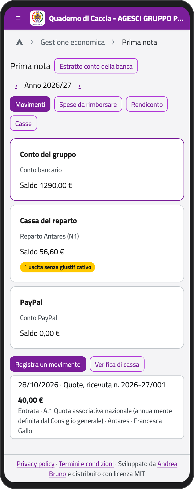
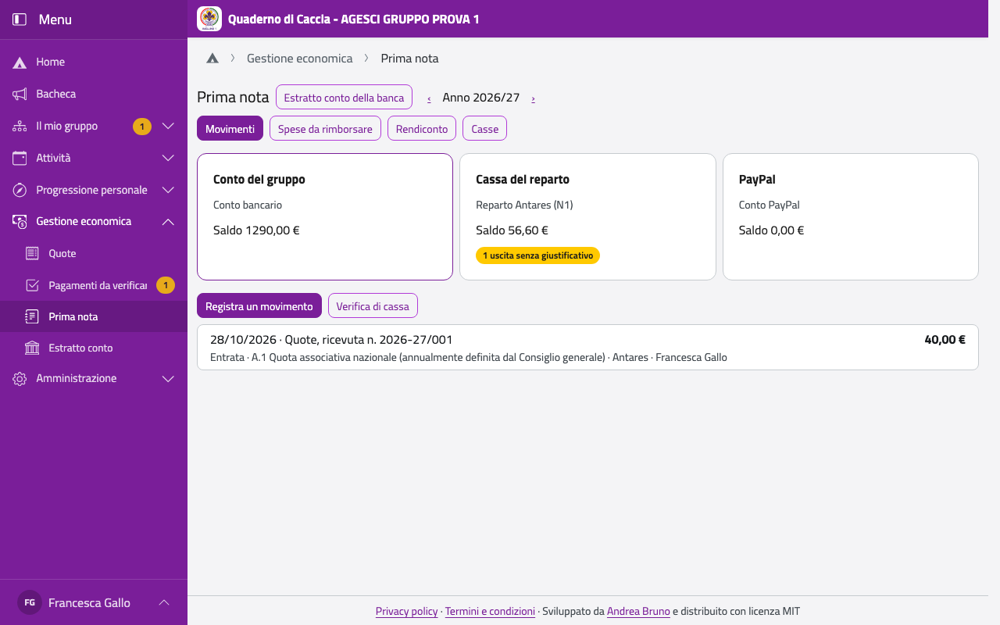

# Prima nota e rendiconto

La prima nota raccoglie tutte le entrate e le uscite del gruppo, cassa per cassa, con le voci
del Modello D. Le casse le configurano il tesoriere di gruppo e i capigruppo; il tesoriere di
un'unità e il capo unità registrano i movimenti della loro unità.

Nella Home, in **Gestione economica**, tocca **Prima nota**.

:::{container} schermate
{.telefono width="30%"}
{.computer width="65%"}
:::

## Le casse

Nella scheda **Casse** (solo per il gruppo): **Nuova cassa**, con nome, tipo, saldo
iniziale e data. Di solito servono un **conto bancario** del gruppo e una **cassa contanti**
per ogni unità; il **conto PayPal** si crea da solo quando abiliti PayPal nelle Impostazioni.
Il saldo iniziale non si cambia dopo i primi movimenti.

## Registrare un movimento

Anche senza rete:

1. Tocca **Registra un movimento** sotto la cassa.
2. Scegli **Uscita**, **Entrata** o **Giroconto verso un'altra cassa** (per esempio un
   prelievo dal conto per la cassa del reparto).
3. Scrivi data, importo e descrizione, e scegli la **Voce del Modello D**.
4. Se serve, scegli l'**evento** (per il suo rendiconto) e, per il conto bancario, l'unità.
5. Aggiungi la **foto dello scontrino o della fattura**: senza, l'uscita resta segnalata
   finché non la aggiungi (**Aggiungi foto**).
6. Tocca **Registra**.

Un movimento non si modifica: se è sbagliato, **Storna** con il motivo e registralo di
nuovo. Le entrate delle quote non si stornano: si annulla il pagamento.

## La verifica di cassa

Ogni tanto conta i soldi (o guarda l'estratto conto) e tocca **Verifica di cassa**: scrivi
il saldo contato; se non torna con quello dell'app, scrivi il motivo e la differenza diventa
una rettifica.

## Le spese da rimborsare

Nella scheda **Spese da rimborsare** ci sono le spese che i capi hanno pagato di tasca loro
(dalla pagina **Le mie spese**), con lo scontrino. **Rimborsa** e scegli da quale cassa:
diventa un'uscita alla voce «Rimborsi spese volontari». Oppure **Respingi**, con il motivo.

## Il rendiconto

Nella scheda **Rendiconto** trovi i totali dell'anno nell'ordine del Modello D, da ricopiare
sull'app nazionale, e i saldi di oggi. I giroconti e le rettifiche non sono né entrate né
uscite.
