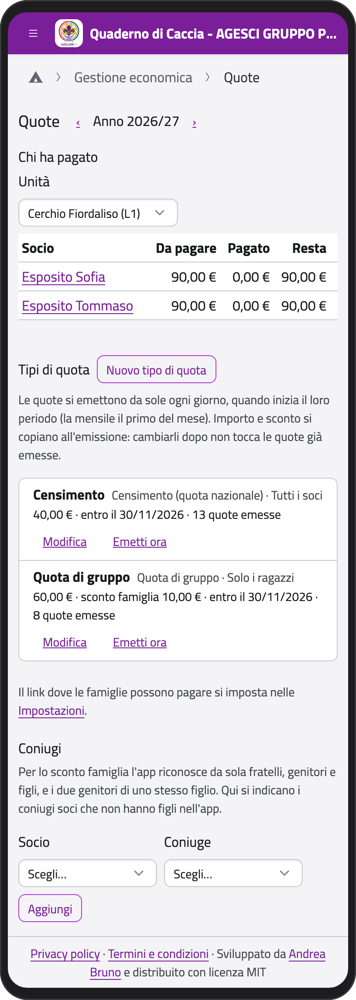
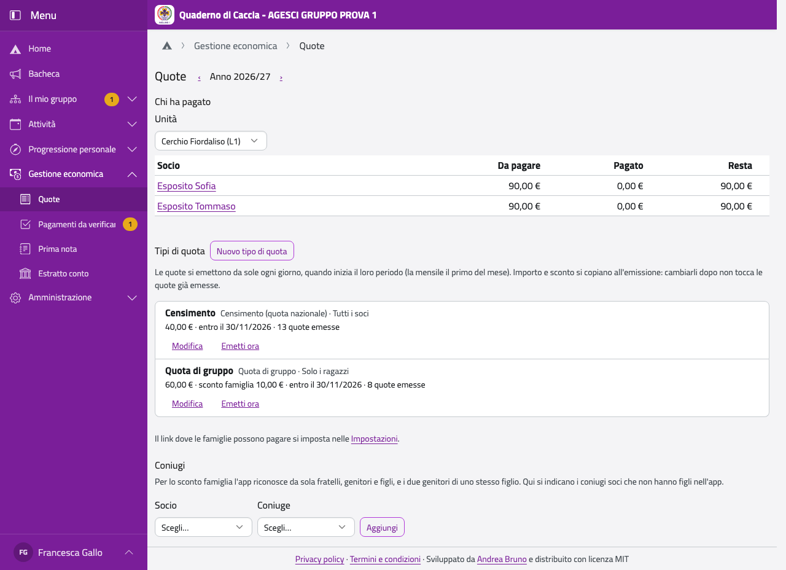

# Quote

Le quote le gestiscono il **tesoriere di gruppo** e i **capigruppo**. Il tesoriere di
un'unità e il capo unità registrano i pagamenti dei ragazzi della loro unità; tutti i capi
vedono chi ha pagato.

Nella Home, in **Gestione economica**, tocca **Quote**. In alto scegli l'anno scout (da
ottobre a settembre); in **Chi ha pagato** vedi, unità per unità, quanto deve ogni socio,
quanto ha pagato e quante quote sono scadute.

:::{container} schermate
{.telefono width="30%"}
{.computer width="65%"}
:::

## I tipi di quota

Ogni anno, in **Tipi di quota**, tocca **Nuovo tipo di quota**:

1. Scrivi il **Nome** e scegli il **Tipo**: **Censimento** (la quota nazionale), **Quota di
   gruppo** o **Quota mensile di unità**.
2. Scrivi l'**Importo** e lo **Sconto famiglia**, che si toglie a ognuno quando in famiglia
   ci sono almeno due soci (il censimento non ha sconto).
3. In **Chi la paga** scegli tutti i soci, solo i ragazzi, solo i capi o alcune unità.
4. Scegli la **Scadenza** (per la mensile, i mesi e il giorno del mese entro cui pagare).
5. Tocca **Salva**.

Le quote si **emettono da sole** ogni giorno, quando inizia il loro periodo (la mensile il
primo del mese); con **Emetti ora** le emetti subito. Importo e sconto si copiano
all'emissione: cambiarli dopo non tocca le quote già emesse.

:::{note}
L'app riconosce da sola le famiglie: fratelli, genitori e figli, i due genitori di uno
stesso figlio. Due coniugi soci senza figli nel gruppo li indichi tu, in **Coniugi**.
:::

Sette giorni prima della scadenza le famiglie ricevono un promemoria per email (chi non
l'ha disattivato). Le quote non pagate degli anni passati restano dovute, con il segno
**anno precedente**.

## Le agevolazioni

Quando la Comunità capi decide che il gruppo copre una parte della quota di qualcuno:

1. Nella scheda della persona, nel riquadro **Quote**, tocca **Agevolazione** accanto alla
   quota.
2. Scrivi l'**Importo coperto**, quando l'ha decisa la Co.Ca. e, se serve, una nota (la
   leggono solo i capi).
3. Tocca **Salva**.

La famiglia vede solo l'importo già ridotto; i tesorieri di unità rover e scolte non vedono
mai le agevolazioni.

## Annullare una quota

Una quota emessa per errore, se non è stata pagata, la annullano il tesoriere di gruppo o un
capogruppo: **Annulla** accanto alla quota, con il motivo.
