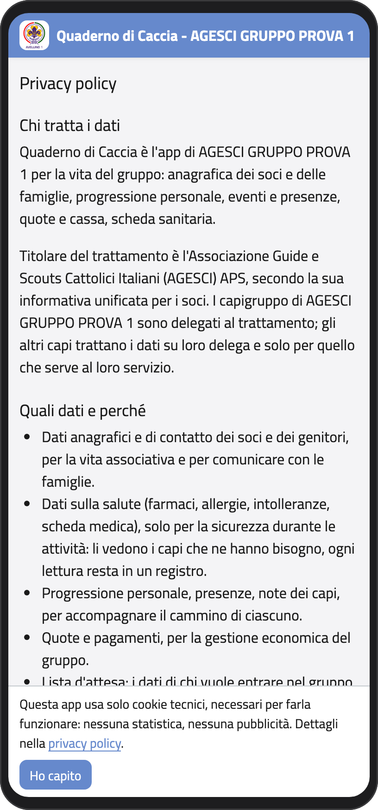
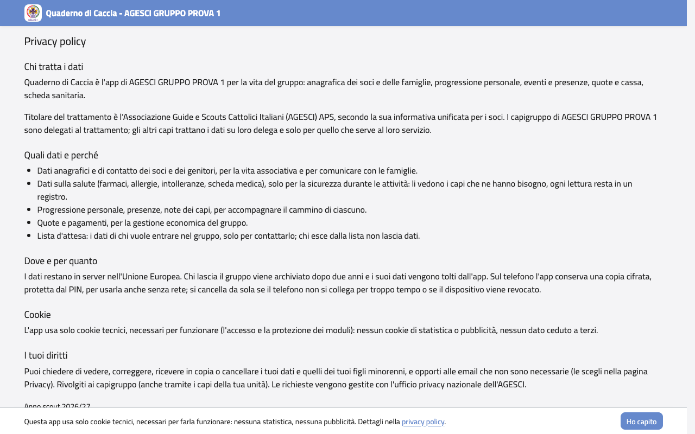
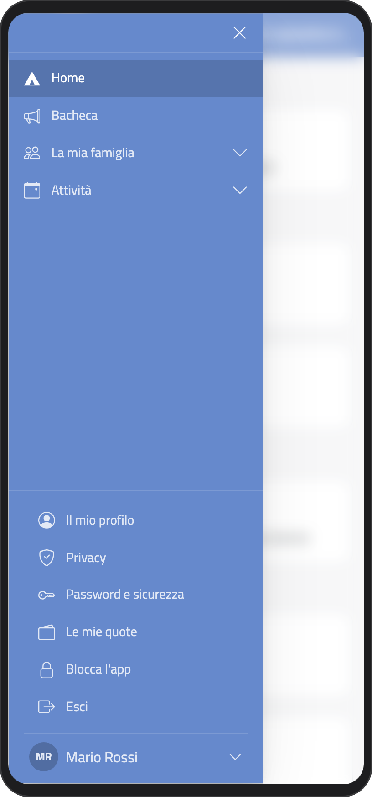
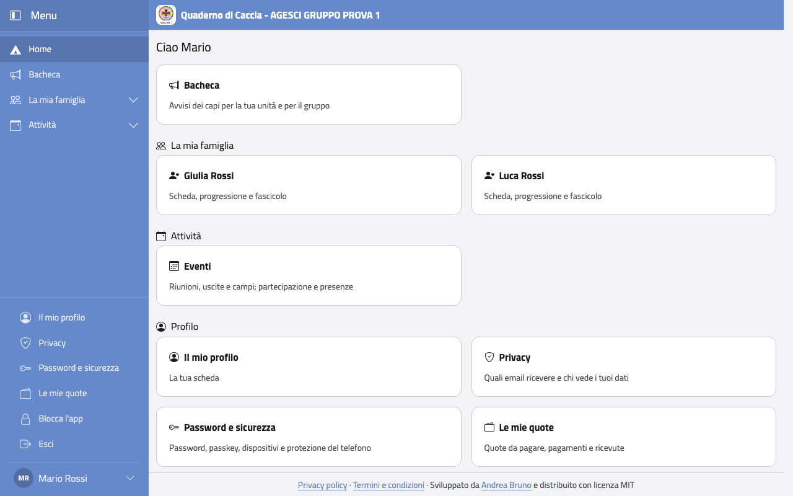

# Introduzione

## Cos'è il Quaderno di Caccia

È l'app del gruppo Avellino 1. Ci trovi i dati dei tuoi figli (o i tuoi, se sei un
ragazzo o un capo), gli eventi e le presenze, le quote da pagare, la Progressione
Personale e gli avvisi dei capi.

Ognuno vede solo la sua parte: un genitore vede i suoi figli, un ragazzo vede sé stesso,
un capo vede i ragazzi della sua unità. In ogni capitolo trovi scritto chi può usare
quella funzione.

## Come si apre

Il Quaderno di Caccia è un sito: lo apri con il browser all'indirizzo
**<https://qdc.avellino1.it>**, dal telefono o dal computer. Non serve scaricare niente
dagli store.

Sul telefono puoi metterlo nella schermata Home, come un'app:

- **Android (Chrome):** apri il menu (i tre puntini in alto a destra) e tocca **Aggiungi a schermata
  Home** (o **Installa app**).
- **iPhone (Safari):** tocca il tasto Condividi (il quadrato con la freccia) e poi
  **Aggiungi alla schermata Home**.

Da lì in poi lo apri con la sua icona, come le altre app.

La prima volta, in fondo alla pagina compare un avviso: l'app usa solo i cookie tecnici
che le servono per funzionare, niente statistiche e niente pubblicità. Tocca **Ho
capito**. In fondo a ogni pagina trovi i link alla **Privacy policy** (chi tratta i dati e
quali sono i tuoi diritti) e ai **Termini e condizioni**.

:::{container} schermate
{.telefono width="30%"}
{.computer width="65%"}
:::

## Come ci si muove

Quando entri vedi la **Home**: le funzioni che puoi usare, divise in gruppi (per esempio
**La mia famiglia** e **Attività**). Tocca un riquadro per aprirlo.

Le stesse funzioni sono nel **menu laterale**. Sul computer è sempre a sinistra; sul
telefono lo apri con il pulsante con le tre righe, in alto a sinistra. Tocca il nome di
un gruppo per vedere le sue voci; la **tenda**, in cima, riporta alla Home.

In fondo al menu c'è il tuo nome: toccalo per aprire il **menu del profilo** (le stesse
voci sono anche nella Home, nel gruppo **Profilo**):

- **Il mio profilo**: la tua scheda;
- **Privacy**: le email che vuoi ricevere;
- **Password e sicurezza**: passkey, dispositivi collegati e protezione del telefono;
- **Le mie quote**: quote, pagamenti e ricevute;
- **Blocca l'app** ed **Esci**.

:::{container} schermate
{.telefono width="30%"}
{.computer width="65%"}
:::

In alto, in ogni pagina tranne la Home, vedi dove sei: la tenda (la Home), il gruppo del
menu e la pagina, per esempio «La mia famiglia › Giulia Rossi › Progressione personale». Tocca la tenda
o una pagina per tornarci.

## Come leggere il manuale

Ogni funzione ha i passi da fare, nell'ordine, con le immagini. Le immagini mostrano il
telefono e il computer: l'app è la stessa, cambia solo come è disposta la pagina.

Le persone negli esempi sono inventate: Mario Rossi, papà di Giulia e Luca; Laura
Bianchi, la capogruppo; Marco Ferri, il capo reparto, e così via.
