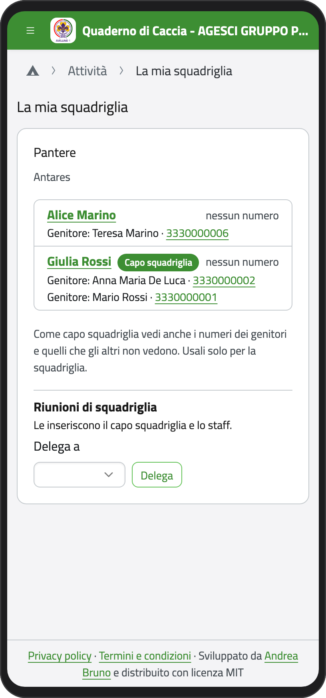
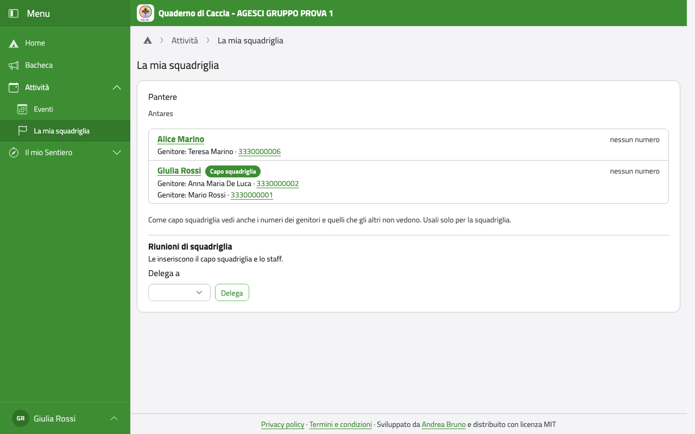
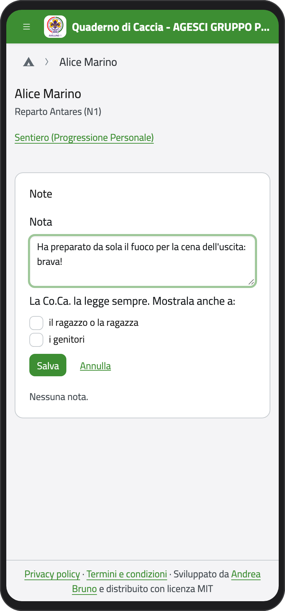
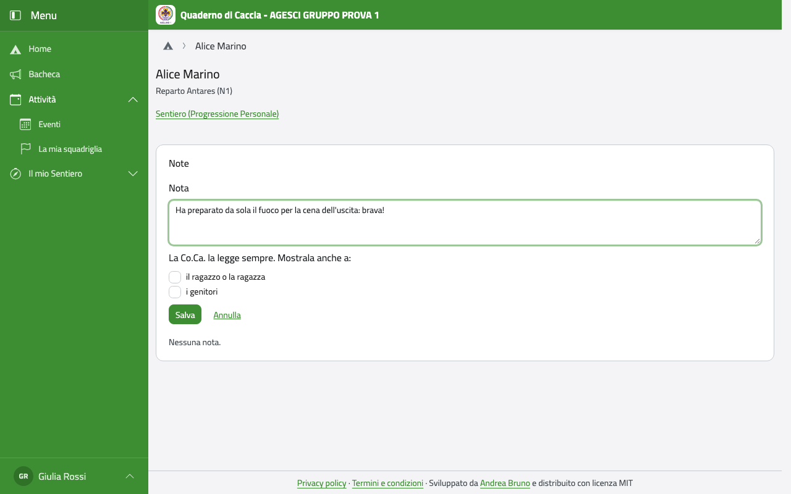

# Capo squadriglia

Se sei capo squadriglia, oltre al tuo Sentiero hai qualcosa in più.

## La tua squadriglia

Nella Home, in **Attività**, tocca **La mia squadriglia**. Vedi gli squadriglieri con il
loro numero di telefono e, solo tu, anche i numeri dei genitori e quelli che gli altri non
vedono. Usali solo per la squadriglia. La pagina funziona anche senza rete.

:::{container} schermate
{.telefono width="30%"}
{.computer width="65%"}
:::

Gli altri squadriglieri vedono solo i numeri gli uni degli altri.

In fondo, in **Riunioni di squadriglia**, puoi delegare uno squadrigliere a inserire anche
lui le riunioni (per esempio quando sei assente): scegli chi in **Delega a** e tocca
**Delega**. Le presenze invece le segni tu.

## Il cammino degli squadriglieri

Tocca il nome di uno squadrigliere: vedi il suo Sentiero (mete, impegni, specialità e
brevetti, tranne quello che ha segnato come riservato). Puoi toccare **Pronto per la
verifica** anche al suo posto, quando ne avete parlato.

## Le note

Nella pagina di uno squadrigliere puoi scrivere una nota, per esempio su come è andata
un'uscita.

1. Tocca **Nuova nota** e scrivi.
2. Le note le legge sempre la Comunità capi. Se vuoi, spunta chi altro la può leggere: lo
   squadrigliere e i suoi genitori.
3. Tocca **Salva**.

:::{container} schermate
{.telefono width="30%"}
{.computer width="65%"}
:::

## Le imprese

In **Il mio Sentiero** trovi anche **Imprese**: le imprese di squadriglia che guidi, con i
posti d'azione e le verifiche, che prepari con il Consiglio d'impresa.
