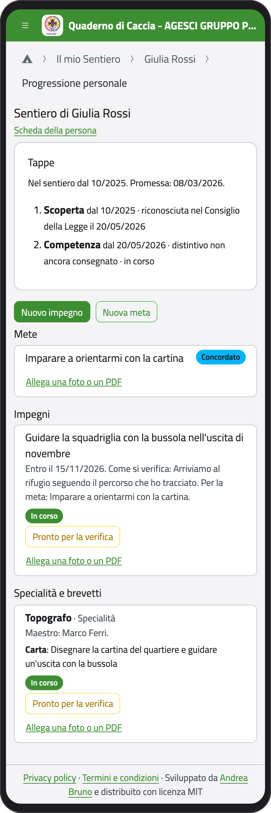
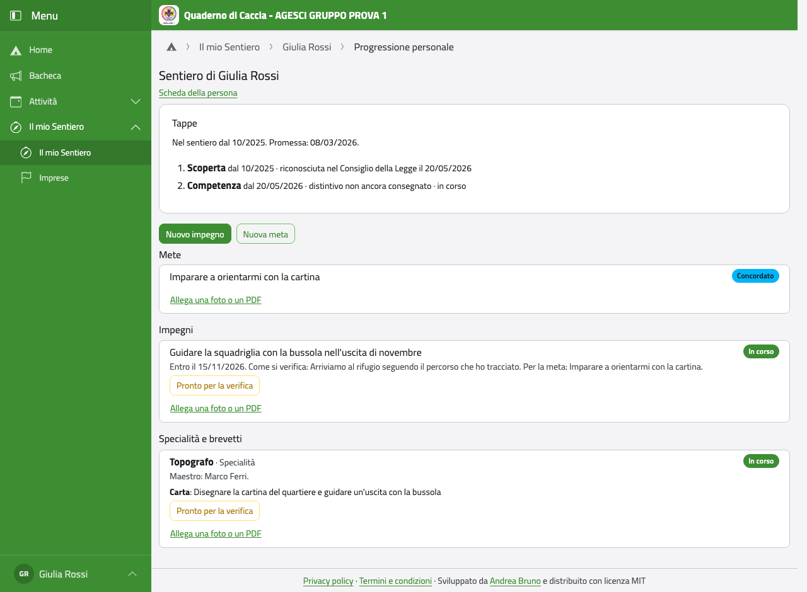
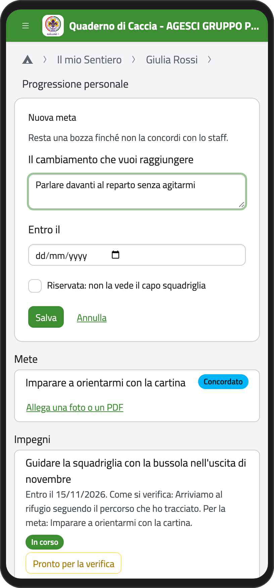
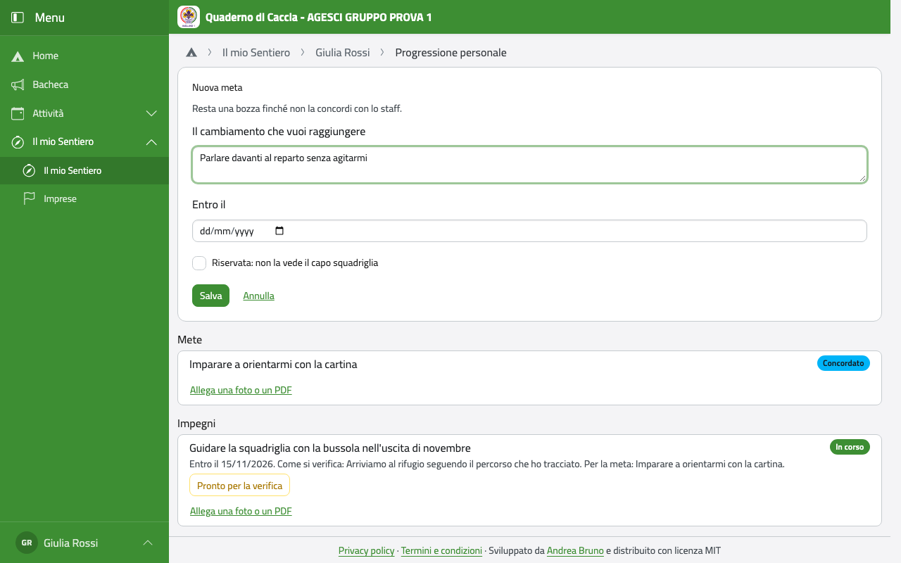
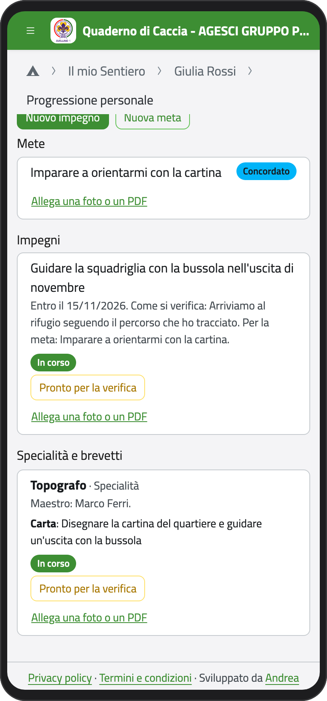
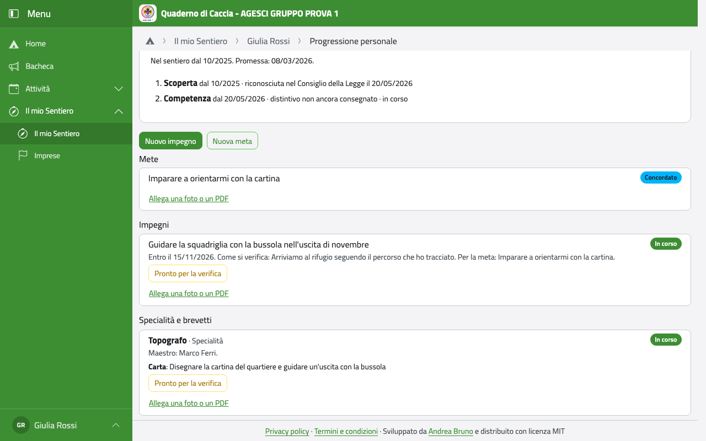

# Esploratori e guide: il tuo Sentiero

Nella Home tocca **Il mio Sentiero**. Trovi:

- le **tappe** (Scoperta, Competenza, Responsabilità), con il giorno in cui il Consiglio
  della Legge le ha riconosciute, e la Promessa;
- le **mete** (il cambiamento che vuoi raggiungere) e gli **impegni** (le cose concrete che
  farai), ognuno con il suo stato;
- le **specialità** e i **brevetti**, con la carta e il maestro;
- i **posti d'azione** che hai avuto nelle imprese.

:::{container} schermate
{.telefono width="30%"}
{.computer width="65%"}
:::

Tappe, Promessa, specialità e brevetti li segnano i capi del reparto. Tu puoi proporre mete
e impegni e dire quando sei pronto per la verifica.

## Proporre una meta o un impegno

1. Tocca **Nuova meta** (o **Nuovo impegno**).
2. Scrivi la meta, cioè il cambiamento che vuoi raggiungere; per un impegno scrivi cosa
   farai, in concreto, come si verifica e per quale meta lo fai.
3. Se vuoi, scegli entro quando. Spunta **Riservata** se non vuoi che la veda il capo
   squadriglia.
4. Tocca **Salva**.

:::{container} schermate
{.telefono width="30%"}
{.computer width="65%"}
:::

La meta resta una **Bozza** finché non ne parli con i capi: quando siete d'accordo diventa
**Concordato**, poi **In corso**. Finché è una bozza puoi cambiarla con **Riformula**.

## Pronto per la verifica

Quando pensi di aver fatto un impegno o una specialità, tocca **Pronto per la verifica**:
diventa **Da verificare** e i capi lo vedono. La verifica la fate insieme (per esempio nel
Consiglio della Legge): se è andata, i capi la convalidano (l'impegno diventa **Concluso**, la specialità
**Conquistato**); se no, prosegue.

:::{container} schermate
{.telefono width="30%"}
{.computer width="65%"}
:::

Con **Allega una foto o un PDF** puoi aggiungere qualcosa che hai fatto: una foto della
costruzione, la cartina che hai disegnato.
