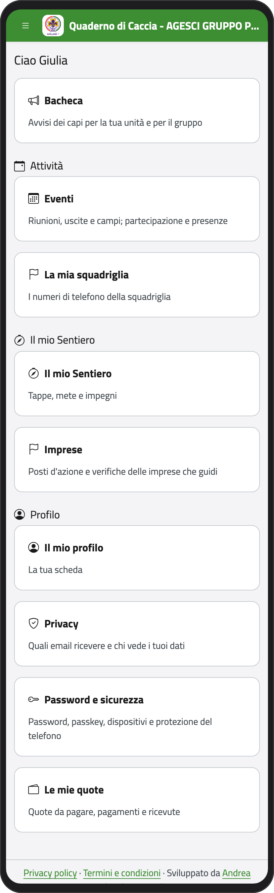
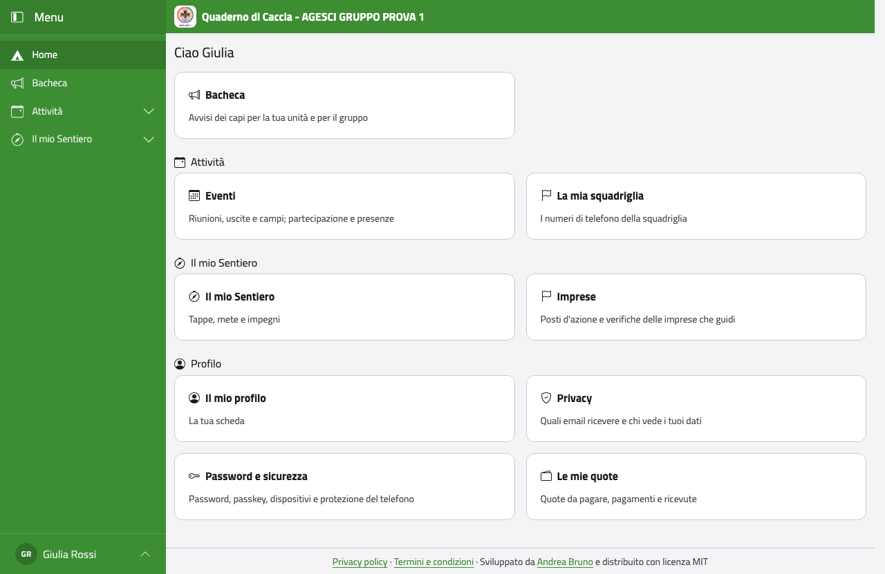

# Ragazzo

## Chi sei, cosa puoi fare

Sei un esploratore o una guida, un rover o una scolta, oppure un lupetto o una coccinella
con un account tuo. Nel Quaderno di Caccia vedi il tuo cammino (la Progressione
Personale), gli eventi della tua unità, gli avvisi dei capi e la tua scheda.

Puoi avere un account tuo dai 14 anni; prima, solo se i tuoi genitori sono d'accordo. Te
lo apre un capo con un invito.

:::{note}
Non vedi le note che i capi tengono per sé, né i dati degli altri ragazzi. In squadriglia
vedete solo i numeri di telefono gli uni degli altri.
:::

Quando entri, la Home ti mostra quello che puoi fare: la **Bacheca**, gli **Eventi** e, se
sei in una squadriglia, **La mia squadriglia**, in **Attività**; il tuo cammino (per
esempio **Il mio Sentiero**); e in **Profilo** la tua scheda, la privacy e la sicurezza.
Le stesse voci sono nel menu (vedi [Come ci si muove](../introduzione.md#come-ci-si-muove)).

:::{container} schermate
{.telefono width="30%"}
{.computer width="65%"}
:::

Leggi i capitoli comuni e poi quello della tua branca. Per ora c'è quello di esploratori
e guide; quelli di lupetti e coccinelle e di rover e scolte arriveranno presto.

```{toctree}
:maxdepth: 1

accesso
scheda
eg
capo-squadriglia
eventi
```
