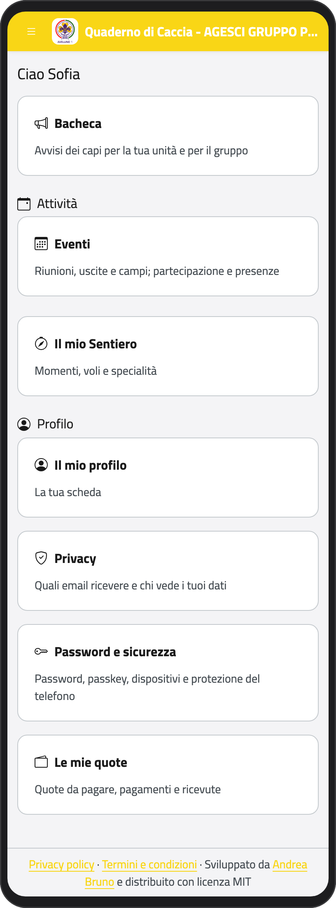
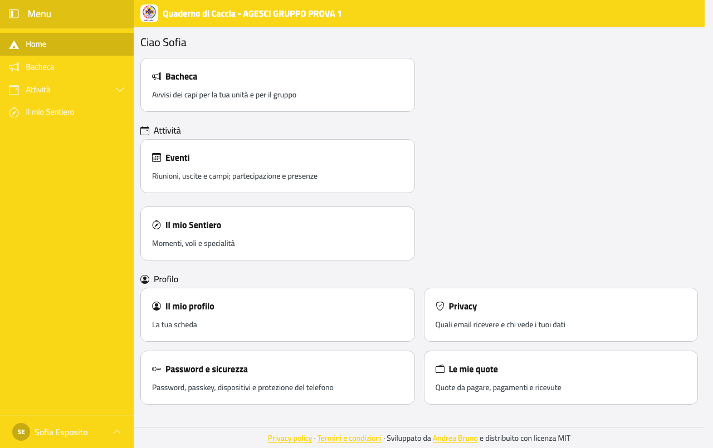
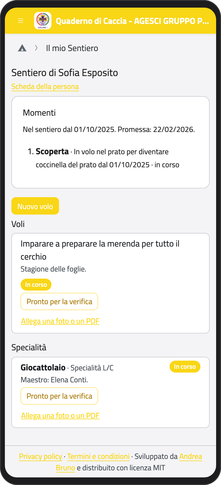
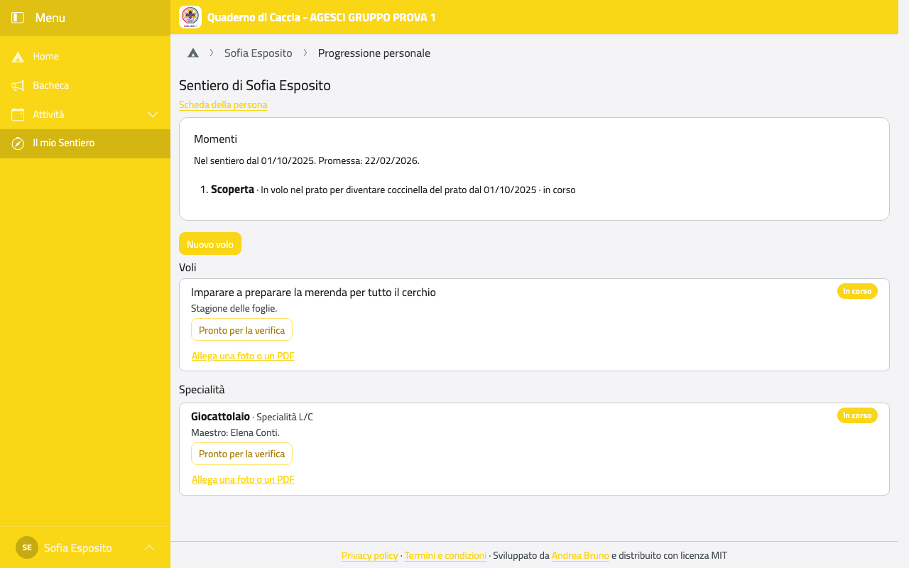

# Lupetti e coccinelle: il tuo Sentiero

% Approvato dal maintainer il 31/10/2026. Gli esempi sono del cerchio di prova, nel bosco;
% per un branco, nella giungla, l'app dice pista, prede e i momenti della caccia.

:::{admonition} Per i genitori
Questo capitolo è scritto per i bambini: leggetelo insieme. Un lupetto o una coccinella ha
un account suo solo se siete d'accordo voi.
:::

Ciao! Qui trovi il tuo cammino nel cerchio. Nella pagina iniziale tocca **Il mio Sentiero**
(se sei un lupetto: **La mia Pista**).

:::{container} schermate
{.telefono width="30%"}
{.computer width="65%"}
:::

## Il tuo momento

In alto vedi a che punto sei del tuo cammino. Per le coccinelle i momenti sono **in volo
nel prato**, **nel bosco** e **sulla montagna**; quando i tuoi capi vedono che sei
cresciuta, diventi **coccinella del prato**, **del bosco**, **della
montagna**. Per i lupetti è **in caccia con Baloo**, **con Bagheera** e **con Akela**, per
diventare **lupo della legge**, **della rupe** e **anziano**.

C'è scritto anche il giorno della tua Promessa.

## I tuoi voli

Un **volo** (per i lupetti, una **preda**) è una cosa che ti impegni a fare in questa
stagione del cerchio: per esempio imparare a preparare la merenda per tutte.

- Accanto a ogni volo vedi a che punto è: **In corso**, poi **Concluso** quando l'hai
  conquistato.
- Quando pensi di avercela fatta, tocca **Pronto per la verifica**: ne parlerai con le
  coccinelle anziane (per i lupetti, i vecchi lupi).
- Con **Allega una foto o un PDF** puoi far vedere cosa hai fatto: un disegno, una foto.

:::{container} schermate
{.telefono width="30%"}
{.computer width="65%"}
:::

Puoi anche proporre un volo nuovo con **Nuovo volo**: scrivi cosa vuoi fare e tocca
**Salva**. Poi ne parli con le coccinelle anziane.

## Le tue specialità

In **Specialità** trovi quelle che stai preparando, per esempio **Giocattolaio**, con chi
ti aiuta (il maestro). Anche qui, quando sei pronta, tocca **Pronto per la verifica**.

## Le Piccole Orme

Se partecipi a delle Piccole Orme, le trovi in fondo alla pagina.
