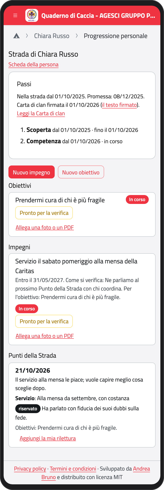
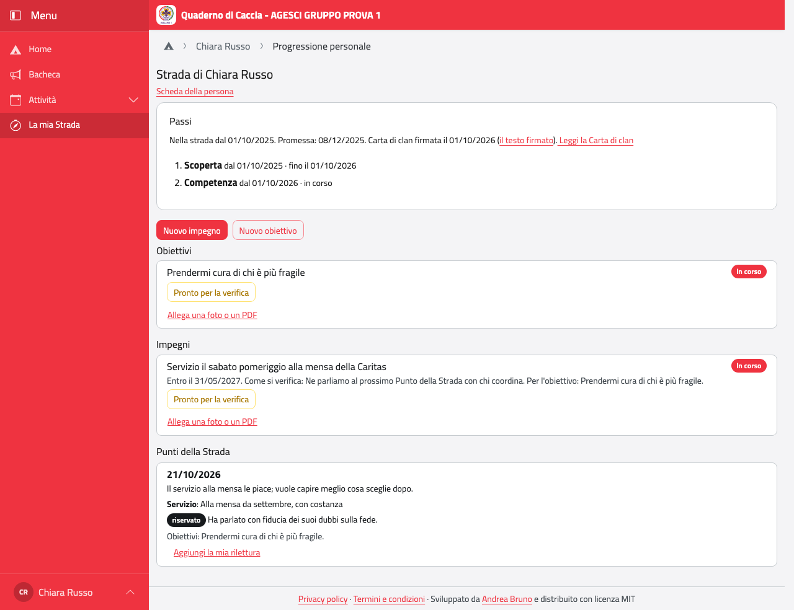
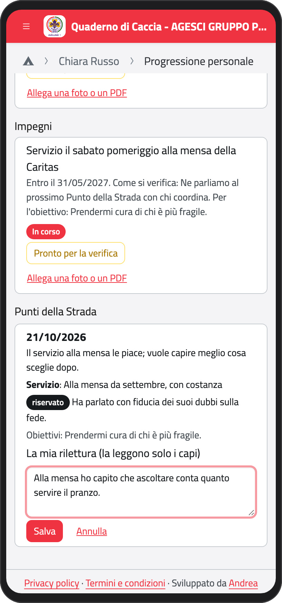
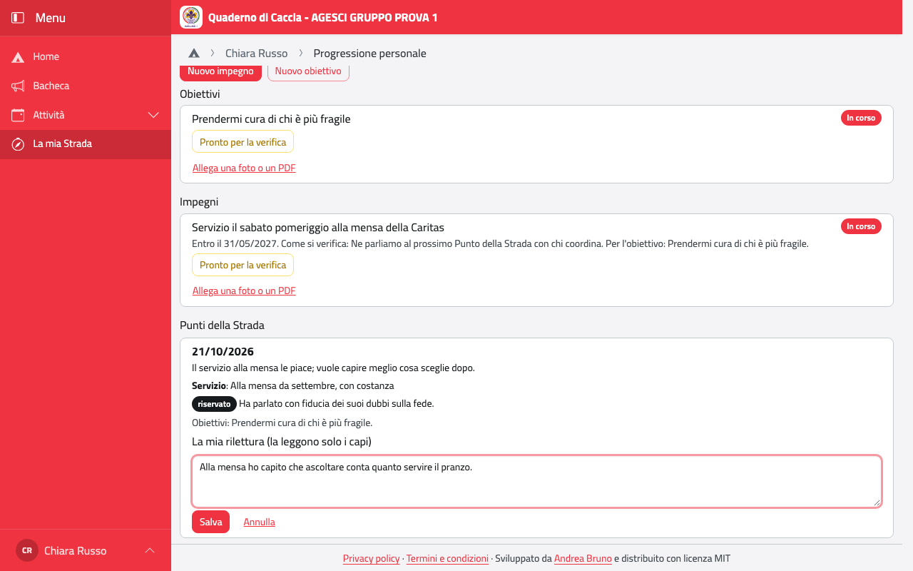
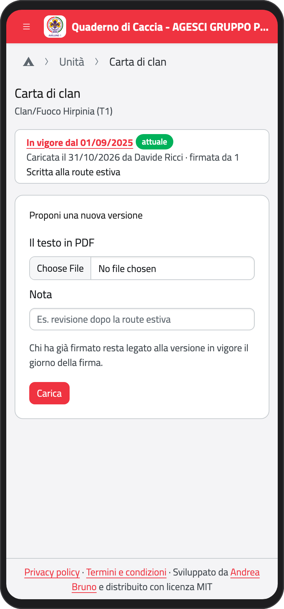
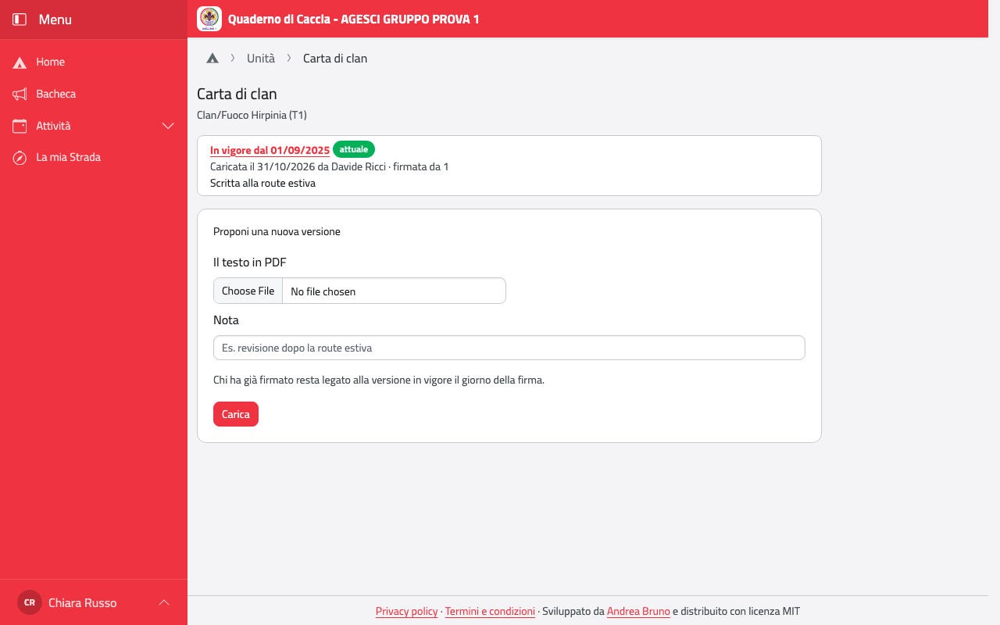

# Rover e scolte: la tua Strada

Nella Home tocca **La mia Strada**. Trovi:

- i **passi** (Scoperta, Competenza, Responsabilità), la Promessa e il giorno in cui hai
  firmato la **Carta di clan**;
- gli **obiettivi** e gli **impegni**, con il loro stato;
- i **Punti della Strada** che hai fatto con i capi.

:::{container} schermate
{.telefono width="30%"}
{.computer width="65%"}
:::

I passi, la firma della Carta e la conclusione del cammino (la Partenza) li segnano i capi
del clan. Tu proponi obiettivi e impegni e scrivi la tua rilettura dei Punti della Strada.

## Obiettivi e impegni

1. Tocca **Nuovo obiettivo** (o **Nuovo impegno**).
2. Scrivi l'obiettivo, cioè il cambiamento che vuoi raggiungere; per un impegno, per
   esempio un servizio, scrivi cosa farai, come si verifica e per quale obiettivo lo fai.
3. Se vuoi, scegli entro quando, e tocca **Salva**.

Resta una **Bozza** finché non ne parli con i capi; poi diventa **Concordato** e **In
corso**. Quando pensi di esserci arrivato, tocca **Pronto per la verifica**: ne parlate
insieme, di solito al Punto della Strada.

## I Punti della Strada

Il Punto della Strada lo scrivono i capi dopo che ne avete parlato: com'è la strada, il
servizio, gli obiettivi fissati o cambiati. Quello che hai detto in confidenza ai capi o
all'assistente ecclesiastico è segnato come **riservato**: lo leggete solo tu e i capi,
**mai i tuoi genitori**.

Puoi aggiungere la tua rilettura:

1. Sotto il Punto della Strada tocca **Aggiungi la mia rilettura**.
2. Scrivi come l'hai vissuto tu. La leggono solo i capi.
3. Tocca **Salva**. Puoi cambiarla dopo con **Modifica la mia rilettura**.

:::{container} schermate
{.telefono width="30%"}
{.computer width="65%"}
:::

## La Carta di clan

In **La mia Strada** tocca **Leggi la Carta di clan**: vedi la versione in vigore e quelle
precedenti, in PDF. Accanto alla tua firma, **il testo firmato** apre la versione che era in
vigore il giorno in cui hai firmato.

Se il clan riscrive la Carta, uno di voi può proporre la nuova versione:

1. In **Proponi una nuova versione** scegli il PDF con il testo.
2. Se vuoi, scrivi una nota (per esempio «revisione dopo la route estiva»).
3. Tocca **Carica**. La versione resta **da approvare** finché lo staff del clan non la
   mette in vigore.

:::{container} schermate
{.telefono width="30%"}
{.computer width="65%"}
:::

:::{note}
Se sei maggiorenne, leggi anche [La tua scheda](scheda.md#quando-compi-18-anni): da 18
anni i tuoi dati li gestisci tu e scegli cosa vedono i tuoi genitori.
:::
