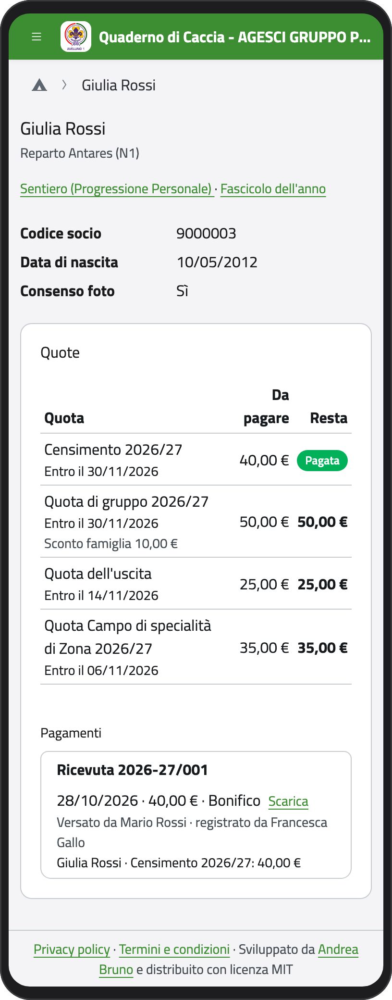
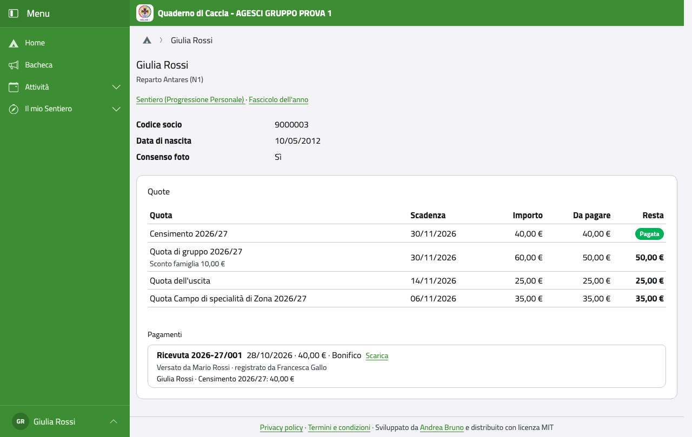

# La tua scheda

Nella Home, in **Profilo**, tocca **Il mio profilo**. Vedi la tua unità, alcuni dati che
vengono da BuonaStrada (l'anagrafe dell'AGESCI), le quote e i collegamenti al tuo cammino
e al **Fascicolo dell'anno** (tutto il tuo anno in una pagina, da scaricare in PDF).

:::{container} schermate
{.telefono width="30%"}
{.computer width="65%"}
:::

Finché sei minorenne, i tuoi dati li scrivono i tuoi genitori: se qualcosa è sbagliato,
diglielo, oppure dillo ai capi.

## Quando compi 18 anni

Da maggiorenne i tuoi dati li gestisci tu:

- **correggi** contatti, indirizzo e consensi dalla tua scheda, con **Correggi un dato**
  (i passi sono quelli in [I tuoi figli](../genitore/figli.md#correggere-un-dato-di-buonastrada));
- compili tu la **scheda sanitaria** (vedi [Scheda sanitaria](../genitore/sanitaria));
- dici tu se partecipi o no a un evento;
- nella pagina **Privacy** scegli **cosa vedono i tuoi genitori**: contatti e indirizzo,
  farmaci e allergie, il resto della scheda, le quote. Finché non scegli, vedono tutto come
  prima.

Un mese prima del compleanno e il giorno dei 18 anni ti arriva un'email che te lo ricorda.
