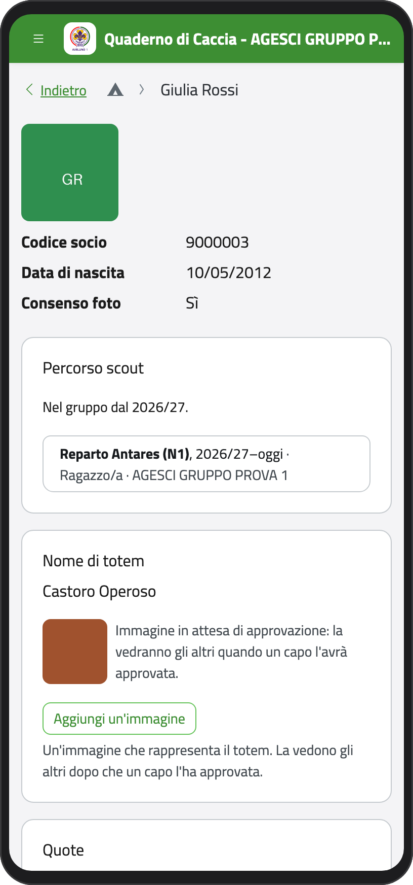
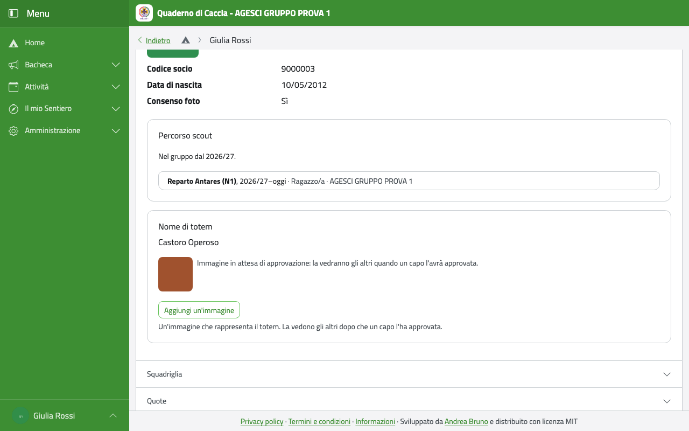
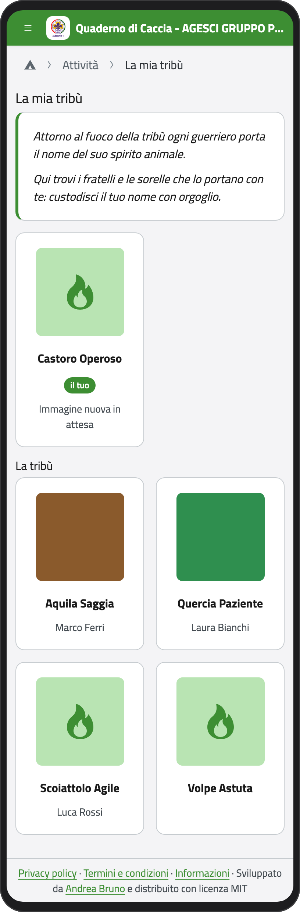
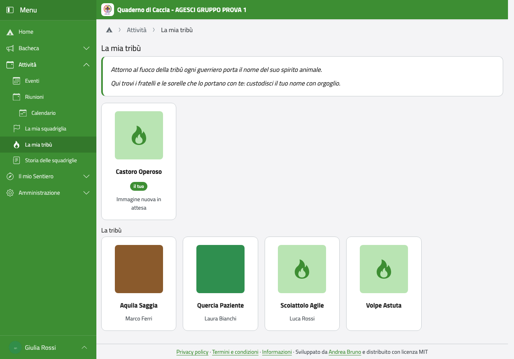
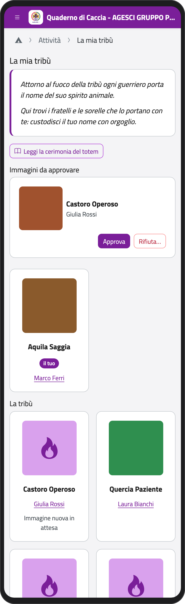
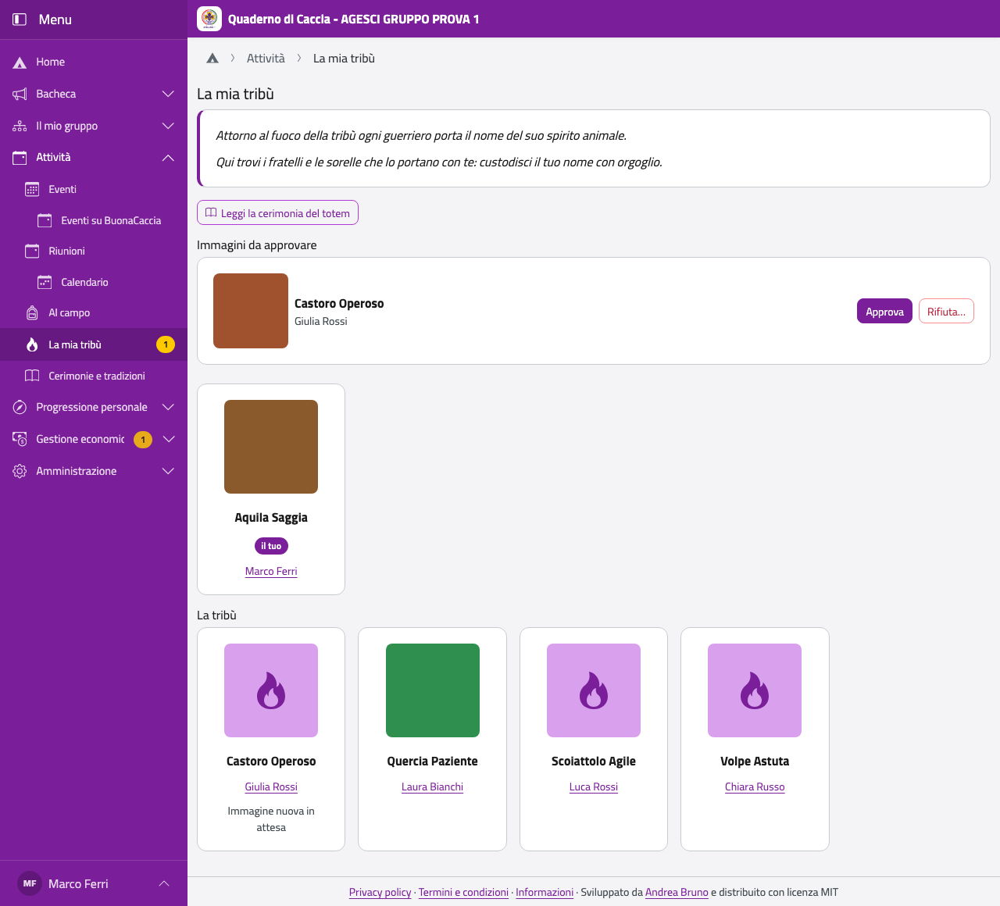
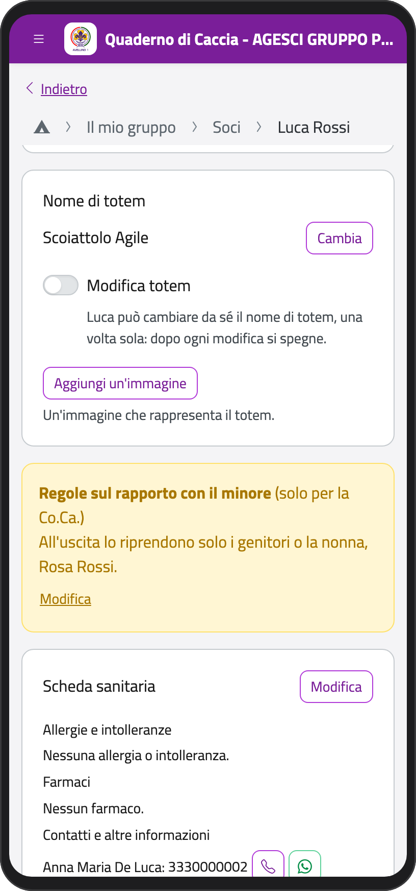
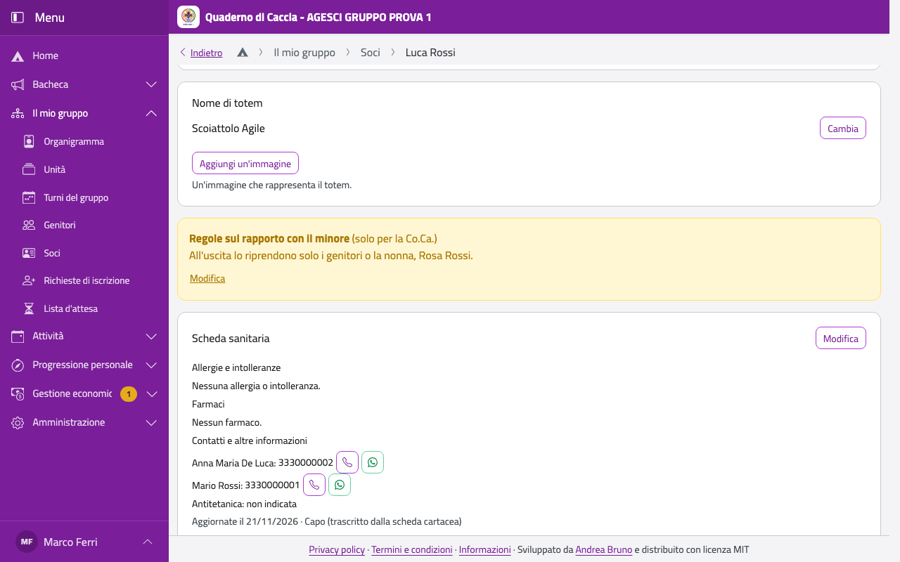
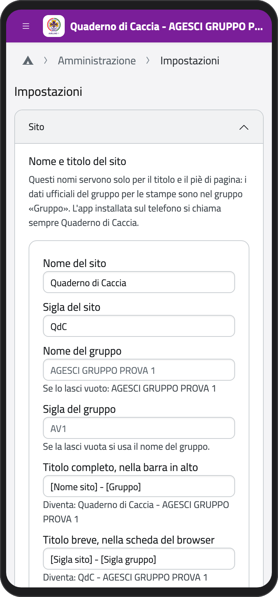
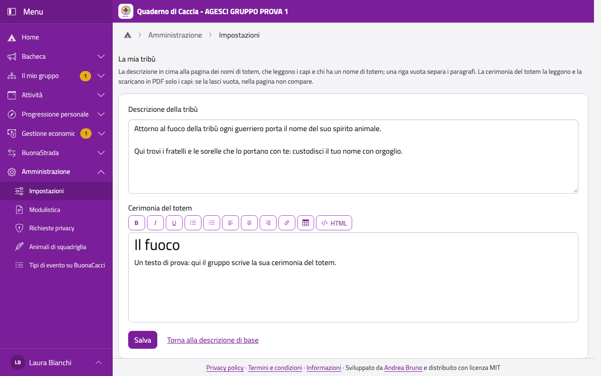

# Nomi di totem e «La mia tribù»

Nel gioco della tribù, chi dal reparto in su ha ricevuto il suo **nome di totem** (il nome di
un animale o di una pianta con un aggettivo, come «Castoro Operoso») lo ritrova nell'app,
con un'immagine che lo rappresenta. I nomi di totem li vedono solo i capi e chi ne ha già
uno: i genitori no.

## Scrivere il tuo nome di totem

Il tuo nome di totem puoi scriverlo tu, quando un capo te lo permette: in **Il mio profilo**
compare il riquadro **Nome di totem** con un messaggio che lo dice. Tocca **Scrivi il tuo
nome di totem** (o **Cambia**, se ne hai già uno), scrivilo e tocca **Salva**.

Puoi farlo **una volta sola**: dopo, per cambiarlo ancora, dovrà permettertelo di nuovo un
capo. Finché non l'hai scritto, **La mia tribù** non mostra niente.

## Se hai un nome di totem

Il tuo nome di totem è in **Il mio profilo** (nella Home, in **Profilo**). Lì puoi
aggiungere o cambiare l'**immagine** del tuo totem: tocca **Aggiungi un'immagine**, sposta e
ingrandisci l'immagine nel riquadro e tocca **Salva l'immagine**.

:::{container} schermate
{.telefono width="30%"}
{.computer width="65%"}
:::

L'immagine la vedono gli altri solo dopo che un capo l'ha approvata: intanto è segnata «in
attesa di approvazione» e resta quella di prima. Se un capo la rifiuta, o la toglie perché
non è adatta, nel profilo leggi il motivo e puoi caricarne un'altra.

In **Attività** trovi **La mia tribù**: la descrizione della tribù, il tuo nome di totem in
cima e quelli di tutti gli altri del gruppo. Per i soci della tua unità e per i capi vedi
anche di chi è il nome; per gli altri solo il nome di totem.

:::{container} schermate
{.telefono width="30%"}
{.computer width="65%"}
:::

## Se sei un capo

Tutti i capi vedono **La mia tribù**, anche senza un nome di totem, e sanno sempre di chi è
ogni nome. Accanto alla voce un numero dice quante immagini aspettano un capo.

:::{container} schermate
{.telefono width="30%"}
{.computer width="65%"}
:::

- **Approvare un'immagine:** in **Immagini da approvare** tocca **Approva**; con
  **Rifiuta…** scrivi il motivo, che legge chi ha il totem.
- **Togliere un'immagine non adatta:** apri la scheda della persona, nel riquadro **Nome di
  totem** tocca **Togli l'immagine perché non è adatta** e scrivi il motivo. Resta traccia
  nel registro delle modifiche.
- **La cerimonia del totem:** se il gruppo l'ha scritta nel libro delle
  [cerimonie e tradizioni](cerimonie.md), in **La mia tribù** tocca
  **Leggi la cerimonia del totem**. La leggono i capi e i ragazzi/e scelti per quella voce.

### Assegnare un nome di totem

Il nome di totem lo assegnano lo staff dell'unità del ragazzo/a e i capigruppo; quello di un
capo i capigruppo. Oppure lo scrive da sé il diretto interessato, se glielo permetti (sotto).

1. Apri la scheda della persona (in **Soci**).
2. Nel riquadro **Nome di totem** tocca **Assegna** (o **Cambia**).
3. Scrivi il nome e tocca **Salva**. Con **Togli il nome di totem** lo togli, con la sua
   immagine.

:::{container} schermate
{.telefono width="30%"}
{.computer width="65%"}
:::

Chi assegna il nome può caricare anche l'immagine, per esempio un disegno fatto al campo:
quella di un capo non aspetta l'approvazione.

### Permettere di scrivere il proprio nome di totem

Se hai un nome di totem, nella scheda di un ragazzo/a o di un altro capo trovi, nel riquadro
**Nome di totem**, l'interruttore **Modifica totem**: accendilo e la persona potrà scrivere
(o cambiare) da sé il proprio nome di totem, una volta sola. Dopo ogni modifica del nome,
chiunque la faccia, l'interruttore si spegne da solo. Il tuo non puoi accenderlo: serve un
altro capo con il totem. L'interruttore lo vedono solo i capi che possono usarlo.

Finché nessun capo del gruppo ha un nome di totem, l'interruttore lo accendono i capigruppo.

## Se sei capogruppo

In **Impostazioni**, nella parte **La mia tribù**, scrivi la **descrizione della tribù** che
compare in cima alla pagina (**Torna alla descrizione di base** rimette quella proposta
dall'app) e tocca **Salva**.

### La cerimonia del totem

La cerimonia del totem si scrive nel libro delle [cerimonie e tradizioni](cerimonie.md): in
una voce di tutto il gruppo spunta **È la cerimonia del totem**, così in **La mia tribù**
compare **Leggi la cerimonia del totem**, che porta a quella voce. Se il gruppo l'aveva già
scritta nelle impostazioni, con l'aggiornamento è diventata una voce del libro, letta come
prima solo dai capi, e il libro si è acceso da solo.

:::{container} schermate
{.telefono width="30%"}
{.computer width="65%"}
:::
